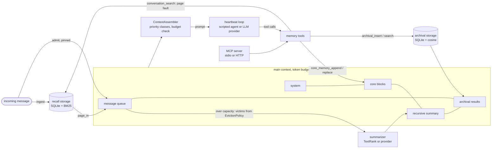

# virtual-context-memory

A Python memory manager that treats an agent's context window like RAM. The prompt has
fixed regions (system text, core memory blocks, a recursive summary, archival search
results) and a message queue whose pages are evicted by a pluggable policy: FIFO, LRU,
ARC with ghost lists, or a Generative-Agents recency + importance + relevance score.
Evicted messages stay in SQLite-backed recall storage and come back on a search, the way a
page fault brings a page back from disk.

The repository also contains a replay benchmark that feeds the LoCoMo conversations
through the manager turn by turn and measures how much gold evidence each method keeps in
the prompt at 1K, 2K and 4K-token budgets.

## Install

Requires Python 3.12 and [uv](https://docs.astral.sh/uv/).

```bash
git clone <this repository> && cd virtual-context-memory
uv sync
uv run vcmem demo          # every policy on a short synthetic chat, no downloads
```

To use it as a library in another project: `uv add <path or git URL>`; the import name is
`vcmem`.

## Quick start

Everything below runs offline: `build_manager` defaults to an in-memory SQLite file, a
regex token counter and a hashing embedder. Pass `make_embedder("minilm")` and
`make_counter("wordpiece")` after `vcmem fetch` to use MiniLM and WordPiece counts.

```python
from vcmem import AssembledContext, MemoryManager, MemoryTools, Message, build_manager

manager: MemoryManager = build_manager(budget=400, policy="arc", core_blocks=("Ana", "Ben"))

turns = [
    ("Ana", "I adopted a greyhound called Pixel from the shelter."),
    ("Ben", "I started training for the Lisbon half marathon in May."),
    ("Ana", "My sister moved to Porto for a nursing job."),
] + [("Ben", f"Unrelated small talk number {i}, nothing to remember.") for i in range(30)]
for i, (speaker, text) in enumerate(turns):
    manager.ingest(Message(f"t{i}", text, speaker=speaker, timestamp="3 March 2024"))

print(manager.stats.evictions > 0, "t0" in manager.resident_ids())  # True False

# A question starts a new step; a search pages the old turn back into the queue.
manager.set_question("What is the name of Ana's dog?")
tools = MemoryTools(manager)
page = tools.conversation_search("greyhound dog")
print(page.paged_in)  # ['t0']

context: AssembledContext = manager.assemble()
assert context.tokens <= context.budget
print("t0" in context.full_sources())  # True
print(context.render())
```

Driving the same tools with an LLM goes through the provider interface, with any server
that speaks the OpenAI chat-completions protocol (OpenAI, Ollama, vLLM, LM Studio):

```python
from vcmem import HeartbeatAgent
from vcmem.providers import OpenAICompatibleProvider

llm = OpenAICompatibleProvider("http://localhost:11434/v1", model="<your model>")
agent = HeartbeatAgent(manager, llm)  # tool calls chain via request_heartbeat
trace = agent.ask("What is the name of Ana's dog?")
print(trace.reply, [c.name for c in trace.calls])
```

## Policy API

A policy orders victims; the manager owns the token accounting and decides how much to
evict. Sizes are in tokens.

| event | called when | 
|---|---|
| `admit(key, info, now)` | a page enters the queue: a new message, or a page fault from recall storage |
| `touch(key, now)` | a resident page is referenced again (a search hit already in context) |
| `victim(pinned) -> key or None` | the queue is over capacity; never return a pinned key |
| `evict(key)` | the manager removed the page (ARC keeps a ghost) |
| `resident() -> list[key]` | the resident set, for checkpoints and tests |
| `observe_query(embedding)` | once per step with the input's embedding, if `uses_features` is true |

`PageInfo` carries `size` (tokens), `importance` (0 to 1) and `embedding`; the last two are
only computed for policies that set `uses_features = True`.

Built-in policies:

| name | evicts | notes |
|---|---|---|
| `fifo` | the page admitted earliest | page faults re-admit at the tail; hits change nothing |
| `lru` | the page referenced least recently | |
| `arc` | LRU of T1 or T2, steered by the adaptive target `p` | token-weighted lists and ghost lists, see [ADR 0002](docs/adr/0002-token-weighted-arc.md) |
| `importance` | the lowest recency + importance + relevance score | Park et al. (2023) scoring, min-max normalised per candidate set |

A custom policy is a subclass plus one registration:

```python
from collections.abc import Container

from vcmem import EvictionPolicy, PageInfo, build_manager, register_policy


class LargestFirst(EvictionPolicy):
    """Evict the longest message first."""

    name = "largest"

    def __init__(self) -> None:
        self.sizes: dict[str, int] = {}

    def admit(self, key: str, info: PageInfo, now: int) -> None:
        self.sizes[key] = info.size

    def touch(self, key: str, now: int) -> None:
        return None

    def victim(self, pinned: Container[str]) -> str | None:
        candidates = [k for k in self.sizes if k not in pinned]
        return max(candidates, key=self.sizes.__getitem__, default=None)

    def evict(self, key: str) -> None:
        del self.sizes[key]

    def resident(self) -> list[str]:
        return list(self.sizes)


register_policy("largest", lambda capacity_tokens: LargestFirst())
manager = build_manager(budget=1024, policy="largest")
```

Budget regions come from `BudgetPlan.split(total, system_tokens)`: core memory, summary
and archival results get fixed shares of the total, a reserve is kept for the question,
and the rest is the queue capacity the policy works with. `MemoryManager(flush_to=...)`
sets the low watermark that batch eviction stops at.

Memory tools, available to the heartbeat loop (as OpenAI function schemas via
`tool_specs()`) and over MCP: `core_memory_append`, `core_memory_replace`,
`archival_insert`, `archival_search`, `conversation_search` (paginated), plus
`send_message` in the loop and `append_message` / `get_context` on the MCP server.

```bash
uv run vcmem serve                                  # MCP over stdio
uv run vcmem serve --transport http --port 8765     # streamable HTTP at /mcp, health at /healthz
```

## Policy versus budget on LoCoMo

Results: pending benchmark. The tables below are filled from
`bench/results/locomo-replay.json` with `vcmem report`; no number is written by hand.

Measured on: Intel i5-8500 (6 cores), 12 GB RAM, Windows 10, CPU only. Date: pending
benchmark.

Evidence recall after the whole conversation (final probe), percent of gold evidence
turns whose full text is in the prompt:

| method | 1024 tokens | 2048 tokens | 4096 tokens |
|---|---:|---:|---:|
| window | pending benchmark | pending benchmark | pending benchmark |
| bm25 | pending benchmark | pending benchmark | pending benchmark |
| dense | pending benchmark | pending benchmark | pending benchmark |
| hybrid | pending benchmark | pending benchmark | pending benchmark |
| memgpt-fifo | pending benchmark | pending benchmark | pending benchmark |
| memgpt-lru | pending benchmark | pending benchmark | pending benchmark |
| memgpt-arc | pending benchmark | pending benchmark | pending benchmark |
| memgpt-importance | pending benchmark | pending benchmark | pending benchmark |

Evidence recall right after the session holding the question's last evidence (fresh
probe): pending benchmark.

Recall by question category, manager latency per turn (p50/p95), latency per question and
SQLite bytes per conversation: pending benchmark.

Not run: answer accuracy (token F1 through an LLM, `--qa-base-url`) and an LLM-driven
agent (`--agent-base-url`). The paging methods above use the scripted agent described
below.

Reproduce:

```bash
export VCMEM_DATA_DIR=~/.cache/virtual-context-memory   # where data and model go
uv run vcmem fetch                                       # LoCoMo + MiniLM, sha256-checked
uv run vcmem bench --out bench/results/locomo-replay.json
uv run vcmem report bench/results/locomo-replay.json
uv run vcmem inspect --sample conv-26 --question 0 --policy arc --budget 1024
```

### What is compared

* `window`: the newest messages that fit.
* `bm25`, `dense`, `hybrid`: the question's top-ranked messages (BM25, MiniLM cosine, or
  reciprocal rank fusion of both) until the budget is full, shown in chronological order.
* `memgpt-<policy>`: the full manager. Every turn is replayed through the heartbeat loop
  with a scripted deterministic agent that uses the same tools an LLM would:
  * on a turn with a recall cue ("remember", "last time", "how's the ..."), one page of
    `conversation_search`;
  * on a first-person statement, `core_memory_append` to the speaker's block, replacing
    the oldest line when the block is full;
  * on a turn whose heuristic importance is at least the archive threshold,
    `archival_insert`;
  * on a question, `conversation_search` pages until half the queue capacity is paged in,
    then `archival_search`.

Each question is asked twice from a checkpoint: after the last turn (final probe, the
LoCoMo setting) and right after the session holding its latest evidence (fresh probe),
see [ADR 0004](docs/adr/0004-measure-evidence-recall-at-two-probe-points.md). Budgets are
counted in WordPiece tokens of the MiniLM tokenizer.

## Concepts

| operating system | here |
|---|---|
| RAM | the prompt, a fixed token budget |
| kernel-resident pages | system text and core memory blocks, never evicted |
| page cache | the message queue |
| replacement policy | `EvictionPolicy` (FIFO, LRU, ARC, importance) |
| disk | recall storage (every message, SQLite + BM25) and archival storage (agent-written passages, SQLite + cosine) |
| page fault | a `conversation_search` hit that is not resident |
| swap-out | eviction, folded into the recursive summary |



## Limitations

* No LLM was run. Answer accuracy and an LLM-driven agent are wired up but not measured;
  evidence recall is an upper bound on what an answering model could use, not accuracy.
* The scripted agent's rules (recall-cue regex, first-person regex, importance threshold)
  shape every `memgpt-*` number. An LLM agent would search and archive differently.
* `HeuristicImportance` is a hand-written heuristic, not the LLM poignancy rating from
  Generative Agents (that path exists as `ProviderImportance`). The archive threshold was
  chosen to archive about 30% of LoCoMo turns, a selectivity target picked before any
  recall was measured, but still a choice made on this dataset.
* Budgets are WordPiece tokens, not the tokens of any particular LLM.
* Tool-call records are not kept in the queue, unlike MemGPT
  ([ADR 0001](docs/adr/0001-page-search-hits-as-message-pages.md)).
* LoCoMo has ten conversations; the open-domain category has 96 questions in total, so
  per-category differences there are noisy. Two evidence ids in the release point at
  turns that do not exist and four questions have no usable evidence; they are dropped
  and counted in the results file.
* One agent per SQLite file, one process. On reopening a database the queue is refilled
  with the newest messages; policy state such as ARC ghost lists is not persisted.

## Data and model licences

| asset | source | licence | how it gets here |
|---|---|---|---|
| LoCoMo `locomo10.json` | [snap-research/locomo](https://github.com/snap-research/locomo), commit `cbfbc1d` | CC BY-NC 4.0 (non-commercial) | `vcmem fetch`; never committed |
| all-MiniLM-L6-v2, quantised ONNX + tokenizer | [Xenova/all-MiniLM-L6-v2](https://huggingface.co/Xenova/all-MiniLM-L6-v2), revision `751bff3` (export of sentence-transformers/all-MiniLM-L6-v2) | Apache-2.0 | `vcmem fetch`; never committed |

`vcmem fetch` downloads into `$VCMEM_DATA_DIR` (default `~/.cache/virtual-context-memory`)
and checks each file against the sha256 recorded in `src/vcmem/assets.py`. LoCoMo's
non-commercial licence applies to anything you derive from the dataset; this code is MIT.

## Development

```bash
uv run pytest                      # default suite: no network, no downloads
uv run pytest -m integration       # needs `vcmem fetch`
uv run ruff check . && uv run ruff format --check .
docker build -t vcmem . && docker run --rm vcmem vcmem demo
```

Design records: [docs/adr](docs/adr/).

## License

MIT, see [LICENSE](LICENSE).
